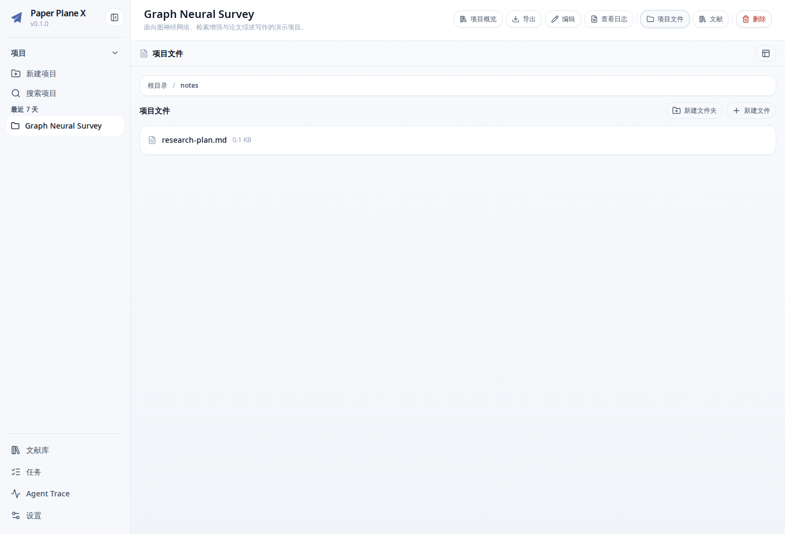
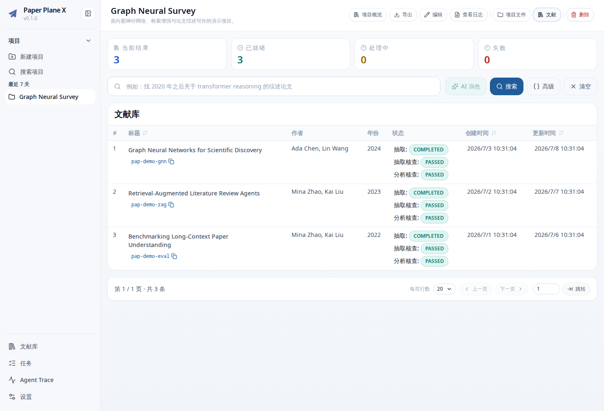
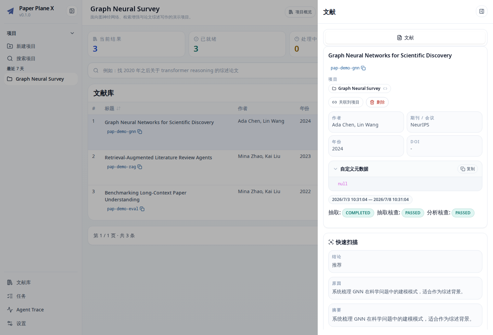
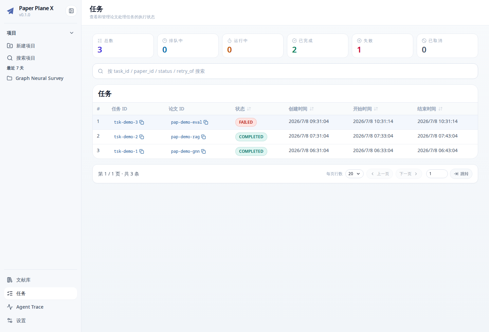
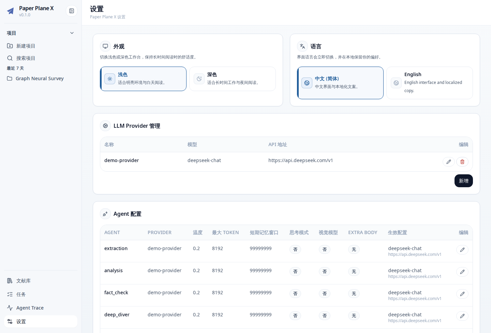

# Paper Plane X Frontend

[](https://vuejs.org/)
[](https://www.typescriptlang.org/)
[](LICENSE)

Paper Plane X Frontend 是 Paper Plane X 的 Vue 3 Web 控制台。它面向日常研究工作，将项目、论文、文献检索、后台任务、Agent traces 和运行时设置集中在一个响应式界面中。

前端不直接访问数据库或文件系统；所有数据均通过 Paper Plane X Backend `/api/v1` API 读取和修改。

## 主要页面

| 页面          | 用途                                                              |
| ------------- | ----------------------------------------------------------------- |
| Projects      | 创建项目，查看项目概览、论文和研究状态                            |
| Project Files | 管理项目笔记、草稿和数据文件，并导出 Markdown、HTML、DOCX 或 PDF  |
| Library       | 浏览和筛选全库论文，打开结构化论文详情                            |
| Tasks         | 查看 PDF 解析和 Agent 后台任务状态                                |
| Agent Traces  | 检查 LLM 调用、工具调用、token 使用和错误                         |
| Settings      | 配置语言、外观、LLM Provider、Agent、PDF Parser、Pandoc 和 worker |

## 批量操作

任务列表、文献库和项目论文页支持多选批量操作：

| 页面       | 可用操作                                       |
| ---------- | ---------------------------------------------- |
| Tasks      | 批量取消、批量重试、批量删除任务               |
| Library    | 批量关联到指定项目、解除指定项目关联、删除论文 |
| 项目论文页 | 批量移出当前项目（论文本身保留）               |

多选与详情单选相互独立：勾选行不会打开详情抽屉，打开详情也不会改变已选集合。选择按 ID 记录，翻页和排序不会丢失；查询条件或项目范围变化时会清空选择。表头复选框可全选当前页或取消本页选择；一旦有选中项，工具条就出现在表格标题右侧，展示已选总数、带图标的批量操作按钮和清除选择按钮，零选择时不占用表头空间。标题栏固定高度，操作区在窄屏下横向滚动，不因勾选而增高。

批量执行前会逐项重新校验：任务通过一次实时任务查询确认状态，论文通过一次批量查询确认存在性、关联关系和解析状态；校验或执行失败会明确显示为失败项而不是被吞掉。批次最多 3 个并发请求，且同一时间只允许一个批次运行。不满足执行条件的项标记为跳过并给出具体原因（对象不存在、已关联该项目、未关联该项目、状态不符，例如仍在排队或解析中的论文不能删除），失败的项保留选择并显示原因，成功的项自动取消勾选，列表和当前详情随后刷新；论文批量校验按 100 条分块，某块失败只影响该块的条目。重试成功后会展示新的任务 ID。取消、删除和解除关联都会先弹出确认对话框，列出受影响的 ID。页面卸载后会中止派发，不再发起后续写请求。

结果由 `src/components/bulk/BulkResultPanel.vue` 逐项展示；调度逻辑集中在 `src/utils/bulkRunner.ts`（有界并发 runner），选择状态在 `src/composables/useBulkSelection.ts`。

### Bulk actions

The task list, library, and project papers pages support multi-select bulk actions:

| Page           | Available actions                                             |
| -------------- | ------------------------------------------------------------- |
| Tasks          | Cancel, retry, or delete selected tasks                       |
| Library        | Link to a project, unlink from a project, or delete papers    |
| Project papers | Remove selected papers from the current project (papers stay) |

Multi-select is independent from opening a detail drawer: checking a row never opens the drawer, and opening the drawer never changes the selected set. Selection is tracked by ID, so paging and sorting keep it intact; changing the search query or project scope clears it. The header checkbox selects or clears the current page; once rows are selected, the bulk toolbar appears to the right of the table title with the selected count, icon action buttons, and a clear control, and it takes no header space while nothing is selected. The header keeps a fixed height; narrow action areas scroll horizontally without increasing its height.

Before a batch runs, every item is re-validated: tasks go through a fresh fetch to confirm their status, and papers go through a batch-get to confirm they still exist, how they are linked, and whether processing allows the action. Validation and execution failures are reported as failed rows instead of being swallowed. A batch uses at most three concurrent requests, and only one batch may run at a time. Ineligible items are marked as skipped with a specific reason (no longer exists, already linked, not linked, or the current status blocks the action, such as deleting a paper that is still queued or processing), failed items stay selected with their reason, and successful items are unselected automatically before the list and the open detail refresh. Paper verification runs in chunks of 100, and a failing chunk only fails its own items. A successful retry shows the new task ID. Cancel, delete, and unlink open a confirmation dialog that lists the affected IDs. Unmounting the page aborts dispatch, so no further write requests are started.

Results are rendered per item by `src/components/bulk/BulkResultPanel.vue`; scheduling lives in `src/utils/bulkRunner.ts` (bounded-concurrency runner) and selection state in `src/composables/useBulkSelection.ts`.

## 界面预览

### 项目文件



### 文献库与论文详情





### 任务与设置





## 面向用户

普通用户无需克隆或构建 frontend。推荐从 Paper Plane X Release 下载 `paper-plane-x-console-vX.Y.Z.tar.gz`，解压到独立 backend 仓库的 `data/console/`，再由 backend 直接托管。Docker 镜像也已经内置对应版本的 Web Console。

完整安装说明见 [Paper Plane X monorepo](https://github.com/WindLX/paper_plane_x)。

### 首次使用流程

1. 打开 Settings，添加 LLM Provider。
2. 为所有 Agent 绑定 Provider。
3. 选择并配置本地或云端 PDF Parser。
4. 如需文档导出，配置 Pandoc 和 PDF engine。
5. 创建项目，并通过 Web 或 Zotero 上传论文。
6. 在 Tasks 中等待处理完成。
7. 在 Library 或项目论文页查看结构化结果。
8. 在 Project Files 中沉淀笔记、矩阵和草稿。

## 面向开发者：快速开始

### 运行要求

- Node.js 24（与 CI 一致）
- pnpm 10+
- 正在运行的 Paper Plane X Backend

### 在 monorepo 中开发

```bash
git clone --recursive https://github.com/WindLX/paper_plane_x.git
cd paper_plane_x/paper_plane_x_frontend
pnpm install
cp .env.example .env
pnpm dev
```

### 独立克隆 frontend

```bash
git clone https://github.com/WindLX/paper_plane_x_frontend.git
cd paper_plane_x_frontend
pnpm install
cp .env.example .env
pnpm dev
```

默认开发地址是 `http://127.0.0.1:5173`。

## API 配置

开发环境默认连接：

```text
http://127.0.0.1:8000/api/v1
```

在 `.env` 或 `.env.development` 中覆盖：

```dotenv
VITE_API_BASE_URL=http://127.0.0.1:8000/api/v1
```

API base URL 的优先级：

1. backend 托管页面时注入的运行时配置；
2. `VITE_API_BASE_URL`；
3. 默认值 `http://127.0.0.1:8000/api/v1`。

不要在 `VITE_*` 变量中放置 API key 或其他秘密；Vite 会把公开环境变量编译进浏览器产物。

## 构建与部署

### 独立静态站点

```bash
pnpm build
```

产物位于 `dist/`。独立部署时需要配置 `VITE_API_BASE_URL`，并确保 backend CORS 允许该站点来源。

### 由 backend 托管（推荐）

```bash
pnpm build:console
```

产物写入：

```text
../paper_plane_x_backend/data/console/
```

随后启动 backend 并访问 `http://127.0.0.1:8000`。这种模式由 backend 注入 API 地址，无需为每个部署环境重新构建 frontend。

快速构建（跳过 typecheck，仅适用于已单独完成类型检查的流程）：

```bash
pnpm build:console:fast
```

## 项目结构

```text
src/
├── api/          # HTTP 与 WebSocket API clients
├── components/   # 可复用 UI 与业务组件
├── composables/  # 页面和业务控制器
├── i18n/         # 中文与英文文案
├── router/       # Vue Router
├── stores/       # Pinia stores
├── types/        # API 与领域类型
└── views/        # 页面入口
```

设计约定位于 [`design-system/`](design-system/)。新增页面或组件时，应优先复用现有 token、`AppButton`、`AppSelect`、modal、notify 和 layout 组件。

## 开发命令

推荐使用 `just`：

```bash
just setup
just dev
just format-check
just lint
just typecheck
just test
just build
just build-console
just pre-commit
```

对应 pnpm 命令：

| 命令                 | 作用                          |
| -------------------- | ----------------------------- |
| `pnpm dev`           | 启动 Vite 开发服务器          |
| `pnpm lint`          | 执行 ESLint                   |
| `pnpm lint:fix`      | 修复可自动处理的 lint 问题    |
| `pnpm format`        | 使用 Prettier 格式化          |
| `pnpm format:check`  | 检查格式，不修改文件          |
| `pnpm test`          | 运行 Vitest                   |
| `pnpm build`         | 运行 `vue-tsc` 并构建独立站点 |
| `pnpm build:console` | 构建 backend-hosted console   |

## 测试与质量要求

- 配置、API client 和纯逻辑优先添加 Vitest 测试。
- UI 行为改动至少运行 `pnpm lint` 和 `pnpm build`。
- API schema 变更应同步更新 `src/types/api` 和调用方。
- 用户可见文案必须同时更新中文和英文 i18n。
- UI 变化请在 PR 中附前后截图或录屏。

提交前执行：

```bash
just pre-commit
```

## 贡献与 Pull Request

1. 从最新 `main` 创建功能分支。
2. 保持组件职责清晰，优先复用现有 UI 和 composable。
3. 不要把 API key、`.env`、`dist/` 或 `node_modules/` 提交到仓库。
4. 更新受影响的测试、i18n、类型和 README。
5. 提交前运行 `just pre-commit`。
6. PR 描述应包含动机、用户影响、验证命令；视觉改动请附截图。

如果改动还要求 backend API 变化，应先在 backend 子仓库完成对应 PR，并在说明中链接两个 PR。

问题与功能建议请提交到 [Issues](https://github.com/WindLX/paper_plane_x_frontend/issues)。提交日志或截图前请移除服务地址中的敏感信息和任何访问令牌。

## Release

frontend 版本由 monorepo 根目录 `VERSION` 统一维护。正式发布由顶层 tag workflow 构建一次 Web Console，并生成：

- `paper-plane-x-console-vX.Y.Z.tar.gz`；
- 内置 console 的 backend Docker 镜像。

Web Console 本身仍是标准静态 Vite 构建，但官方 Release 不再重复发布内容相同的 standalone frontend 压缩包。不要在子仓库单独修改版本号；版本变更应通过 monorepo 的 `scripts/sync_version.py` 完成。

## License

Paper Plane X Frontend 使用 [GNU Affero General Public License v3.0 or later](LICENSE)。


## 阅读工作区 / Reading workspace

文献库、项目论文页和项目文件中的论文链接均支持原始 PDF 阅读。左侧导航、详情侧栏与 PDF 分隔条可拖拽或使用方向键、Home/End 调整，双击恢复默认。左右侧栏宽度在操作完成后自动保存，展开和收起 PDF 保留详情宽度。中间画布最小宽度为 960px，空间不足时横向滚动，顶部栏和表格不再继续挤压。阅读区基于实际可用空间分栏，1920×1080 下也不会把右栏撑出屏幕；窄屏打开 PDF 后暂时隐藏详情，关闭 PDF 后恢复。分栏使用 [Reka UI Splitter](https://reka-ui.com/docs/components/splitter)。

Original PDF reading is available in the library, project library and paper links in project files. Drag the navigation/detail/PDF separators or use arrow keys and Home/End; double-click to reset. Sidebar widths are saved after each gesture, and PDF toggles preserve detail width. The middle canvas keeps a 960px minimum width and scrolls horizontally when its pane is narrower. Panes share the available workspace without pushing the right sidebar beyond the viewport; on narrow screens the PDF temporarily replaces details until closed.


### 浏览器布局回归 / Browser layout regressions

运行 `pnpm exec playwright install chromium` 安装测试浏览器，再运行 `just test-browser`。已有 Chromium 时可设置 `PPX_TEST_CHROMIUM=/absolute/path/to/chromium`。测试自行启动独立 Vite 服务，并拦截所有 API 与任务 WebSocket，使用合成论文、文件和 PDF；无需连接后端。覆盖批量操作标题栏固定高度、文件页 PDF、三个分隔条、宽度持久化、PDF 展开/关闭时保留详情宽度、中间横向滚动、拖拽中断和长元数据换行，并检查 1920/1440/1024/768/390px 下的亮暗主题。`just pre-commit` 包含单元测试和构建，浏览器测试需单独运行。

Install the test browser with `pnpm exec playwright install chromium`, then run `just test-browser`; set `PPX_TEST_CHROMIUM` to reuse an existing Chromium executable. Tests start their own Vite server and intercept API/WebSocket traffic using synthetic records. Run browser regressions separately from `just pre-commit`.


## Agent Token 预算 / Agent token budgets

Settings 中六个 Agent 默认使用 `max_total_tokens = 240000`，含系统提示、历史、当前输入和本次生成。后端按模型名自动估算输入并分配剩余输出预算，无需选择 tokenizer。旧 `max_tokens` 设置已删除。Provider 高级设置中的上下文和最大生成量可留空使用已知模型信息；自定义网关可选填写实际能力。超预算时后端报告错误，不自动裁剪论文或压缩历史。

All six agents default to `max_total_tokens = 240000` per request. The backend counts inputs and allocates remaining output space automatically, without a tokenizer setting. The legacy `max_tokens` setting is removed. Optional provider context/output capabilities describe custom gateways; oversized inputs report an error rather than being trimmed.
